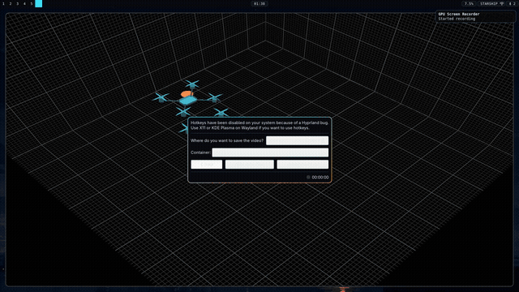

# VizCore

Real-time 3D visualization library for robotics and kinematic simulation telemetry.

VizCore decouples simulation from visualization — your simulation runs independently and pushes data via a `DataBus`, and VizCore renders it in a tiled window with widgets like 3D viewers, line plots, gauges, and data trees.

> **Status:** Early development (v0.0.1). Core rendering, camera, and mesh generation are functional. The full tiled dashboard with widget system is a work in progress.

## Features

- **ModernGL rendering** — OpenGL 3.3 core profile, procedural mesh generation (arrows, cylinders, cones)
- **Orbit camera** — mouse-driven with perspective projection
- **DataBus** — thread-safe signal transport with ring buffers, decoupling sim from viz
- **Simulation framework** — `SimNode` hierarchy with `Signal` descriptors for auto-tracked telemetry
- **Widget system** — 3D kinematic frames, line plots, scalar gauges, data trees, log console
- **Procedural meshes** — coordinate axes, arrows, cylinders, cones generated at runtime

## Installation

```bash
git clone https://github.com/<your-username>/vizcore.git
cd vizcore
pip install -e .
```

### Dependencies

- `moderngl`
- `pyglet`
- `numpy`
- `moderngl-window` (for standalone examples)

## Quick Start

Run the coordinate axes demo:

```bash
python example/coordinate_axes.py
```

This opens a 1024×768 window showing a 3D coordinate frame (red=X, green=Y, blue=Z). Drag with the mouse to orbit the camera.

See `simpleWindow3D.py` and `simulationRoom.py` in the project root for more examples.

### Simulation Room (blips, tiles, model loading)

Run the full simulation-room app:

```bash
cd test_folder
python mainLoop.py
```

Features: 3D world grid with pickable blip markers, a tiled widget dashboard (line plots, gauges, data trees), right-click context menus, and per-blip OBJ model loading/alignment via file dialog.

Demo:



## Architecture

```
vizcore/
├── bus/           DataBus + RingBuffer (signal transport)
├── components/    Widgets (charts, data, debug, visualization)
├── meshes/        Procedural mesh generators + model loader
├── renderer/      Renderer, Camera, TileManager, shaders
├── simulation/    Signal descriptors, SimNode, example sims
├── text/          Font atlas and texture management
└── window/        Tiled window, mainloop, context menus
```

## Conventions

- Column-major 4×4 matrices (OpenGL standard)
- Right-handed coordinate system (+X right, +Y up, −Z forward)
- `float32` throughout

## License

MIT
